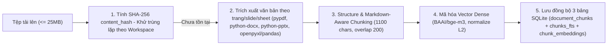
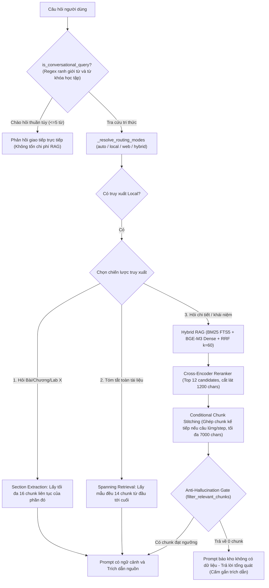

# TÀI LIỆU KIẾN THỨC TRỌNG TÂM VỀ AI TRONG HỆ THỐNG PERSONAL AI KNOWLEDGE PLATFORM (PBL6)

> **Phiên bản mã nguồn tham chiếu:** Nhánh `main` (Commit `ae57e43`)  
> **Kiến trúc tổng thể:** Local-First Hybrid RAG + Local LLM (Ollama) + Semantic Knowledge Management

---

## 📌 1. Tổng quan Kiến trúc AI & Triết lý Local-First

Hệ thống được xây dựng theo định hướng **100% Local-First AI**: toàn bộ dữ liệu tài liệu cá nhân, vector nhúng, chỉ mục tìm kiếm và mô hình ngôn ngữ đều được lưu trữ và thực thi trực tiếp trên máy người dùng (tối ưu cho cấu hình máy cá nhân phổ biến như CPU đa nhân + 16GB RAM + GPU 4GB VRAM), không phụ thuộc API đám mây trả phí. Kết nối Internet chỉ được kích hoạt có kiểm soát ở chế độ **Web** hoặc **Hybrid** khi câu hỏi yêu cầu thông tin thời gian thực.

### 1.1. Ngăn xếp Mô hình AI (Model Stack)

Các tham số cấu hình gốc được định nghĩa tại [config.py](file:///d:/PBl6/sourcecode/backend/app/config.py) và khởi động nóng (warm-up) trong nền khi server bật tại [main.py](file:///d:/PBl6/sourcecode/backend/app/main.py):

| Thành phần | Mô hình / Công nghệ | Thông số & Vai trò cốt lõi | Tệp triển khai |
| :--- | :--- | :--- | :--- |
| **LLM Sinh văn bản** | Ollama (`qwen2.5:7b` mặc định; tùy chọn UI `qwen2.5:3b`, `llama3.2:3b`) | Suy luận tổng hợp câu trả lời RAG, gắn trích dẫn `[n]`, sinh gợi ý câu hỏi tiếp theo và sinh học liệu JSON | [llm_service.py](file:///d:/PBl6/sourcecode/backend/app/services/llm_service.py) |
| **Multimodal / Vision** | `qwen3-vl:2b-instruct` (fallback `qwen2.5vl:3b`) | Đọc hiểu, trích xuất chữ/biểu đồ từ hình ảnh người dùng gửi lên (`PNG`, `JPEG`, `WEBP`, tối đa 5 MB) | [ai_router.py](file:///d:/PBl6/sourcecode/backend/app/services/ai_router.py) |
| **Dense Embedding** | `BAAI/bge-m3` (`sentence-transformers`, fallback `fastembed`) | Mã hóa câu hỏi, chunk tài liệu và hồ sơ workspace thành vector ngữ nghĩa đa ngôn ngữ chuẩn hóa L2, lưu dạng `float32 BLOB` trong SQLite | [embedding_service.py](file:///d:/PBl6/sourcecode/backend/app/services/embedding_service.py) |
| **Sparse Lexical Search** | `SQLite FTS5` (thuật toán `BM25`) | Tìm kiếm khớp chính xác từ khóa, thuật ngữ, tên file, mã hiệu, con số thông qua bảng ảo `chunks_fts` | [database.py](file:///d:/PBl6/sourcecode/backend/app/database.py) |
| **Cross-Encoder Reranker** | `jinaai/jina-reranker-v2-base-multilingual` (`fastembed` ONNX) | Chấm điểm tương tác chéo (Cross-Attention) giữa `(Query, Chunk)` để loại bỏ nhiễu sau bước trộn RRF | [reranker_service.py](file:///d:/PBl6/sourcecode/backend/app/services/reranker_service.py) |

### 1.2. Cơ chế Warm-up & Chạy Offline

- **Khởi động không chặn luồng chính (`lifespan`):** Khi FastAPI khởi động, `_warmup_models()` chạy trong thread pool nền (`loop.run_in_executor`) để nạp sẵn `BAAI/bge-m3` và `jina-reranker-v2-base-multilingual` vào RAM, giúp truy vấn đầu tiên không bị trễ cold-start.
- **Tự động nhận diện Cache Offline:** Trong [embedding_service.py](file:///d:/PBl6/sourcecode/backend/app/services/embedding_service.py), nếu phát hiện thư mục cache cục bộ `~/.cache/huggingface/hub/models--BAAI--bge-m3`, hệ thống tự bật `HF_HUB_OFFLINE=1` và `TRANSFORMERS_OFFLINE=1`, tải model tức thì bằng `local_files_only=True`.

---

## 📥 2. Pipeline Nạp & Lập chỉ mục Tài liệu (Ingestion Pipeline)

Mọi tài liệu tải lên (giới hạn `UPLOAD_MAX_BYTES = 25 MB`, hỗ trợ 10 định dạng: `pdf`, `docx`, `pptx`, `txt`, `md`, `py`, `json`, `csv`, `xlsx`, `xls`) đi qua quy trình xử lý trong [document_service.py](file:///d:/PBl6/sourcecode/backend/app/services/document_service.py):



### 2.1. Chi tiết các kỹ thuật cốt lõi trong Ingestion

1. **Khử trùng lặp thông minh bằng SHA-256 (`content_hash`):**
   - Trước khi trích xuất và nhúng vector, hệ thống tính `hashlib.sha256(file_bytes).hexdigest()` và kiểm tra `documents WHERE workspace_id = ? AND content_hash = ?`.
   - Nếu trùng, tệp tạm bị xóa và hệ thống trả về bản ghi cũ, tránh nhân bản chunk và làm loãng không gian tìm kiếm vector.
2. **Trích xuất bảo toàn vị trí gốc (`page_number`):**
   - `PDF`: Giữ chính xác số trang 1-based theo `pypdf.PdfReader`.
   - `PPTX`: Giữ số thứ tự slide (`page = slide_index + 1`).
   - `XLSX / XLS`: Duyệt từng sheet, nối các ô khác rỗng bằng `" | "`, thêm tiền tố `Sheet: {sheet_name}` và gán số trang theo thứ tự sheet.
3. **Phân đoạn nhận diện cấu trúc (`recursive_chunk_text`):**
   - Thông số mặc định: `CHUNK_SIZE = 1100` ký tự, `CHUNK_OVERLAP = 200` ký tự.
   - **Bảo toàn khối toàn vẹn:** Bộ phân tích tách văn bản thành các block (`code`, `table`, `heading`, `paragraph`), đảm bảo không cắt đôi khối code (```` ``` ... ``` ````) hoặc bảng Markdown (`| ... |`) giữa chừng (chỉ tách nhỏ nếu bản thân 1 khối đơn vượt quá `chunk_size`, khi đó ưu tiên cắt tại `\n` hoặc `. `).
   - **Gắn Breadcrumb cấu trúc (`[active_heading]`):** Nhận diện tiêu đề Markdown (`#`–`######`) hoặc tiêu đề mục (`Chương X`, `Bài X`, `Lab X`, `Phần X`...) và tự động chèn `[active_heading]` vào đầu các chunk kế tiếp thuộc mục đó để tăng độ chính xác cho cả BM25 lẫn BGE-M3.
4. **Lập chỉ mục kép (Dual Indexing) trong SQLite WAL:**
   - Văn bản sạch được lưu vào `document_chunks`.
   - Phiên bản lọc dấu ngoặc kép được đẩy vào bảng ảo `chunks_fts` (SQLite FTS5).
   - Vector chuẩn hóa L2 được đóng gói nhị phân `float32` (`pack_vector`) và lưu vào `chunk_embeddings`. Ngoài ra có hàm `reindex_document_embeddings` để bổ sung/làm mới vector BGE-M3 cho tài liệu chỉ có FTS.

---

## 🔍 3. Kiến trúc Truy xuất Lai (Hybrid RAG Pipeline)

Luồng điều phối câu hỏi nằm ở [ai_router.py](file:///d:/PBl6/sourcecode/backend/app/services/ai_router.py) và lõi tìm kiếm nằm ở [retrieval_service.py](file:///d:/PBl6/sourcecode/backend/app/services/retrieval_service.py).



### 3.1. Phân loại Chitchat chính xác (`is_conversational_query`)

- Chỉ kích hoạt với câu ngắn ($\le 5$ từ) và không đính kèm ảnh.
- Sử dụng biểu thức chính quy có ranh giới từ nguyên (`\b`) kết hợp danh sách từ khóa học tập được bảo vệ (`"thi"`, `"đề"`, `"bài"`, `"chương"`, `"lab"`, `"tài liệu"`, `"sách"`, `"giáo trình"`, `"là gì"`, `"thế nào"`, `"cách"`, `"hướng dẫn"`...).
- Tránh triệt để lỗi khớp chuỗi con (ví dụ: `"đề thi n3"` không bị nhận nhầm là `"hi"`).

### 3.2. Định tuyến Chế độ & Ngữ cảnh Hội thoại

- **4 chế độ (`_resolve_routing_modes`):**
  - `local`: Chỉ truy xuất tài liệu cá nhân.
  - `web`: Chỉ tìm kiếm Internet.
  - `hybrid`: Kết hợp cả Local RAG và Web Search.
  - `auto`: Luôn bật Local RAG; tự động bật thêm Web Search nếu câu hỏi chứa từ khóa nhạy cảm thời gian (`TIME_SENSITIVE_KEYWORDS`: `"hôm nay"`, `"thời tiết"`, `"mới nhất"`, `"giá vàng"`, `"tỷ giá"`, `"chứng khoán"`, v.v.).
- **Xử lý câu hỏi kèm ảnh (`image_base64`):** Nếu người dùng gửi ảnh nhưng không chỉ định `selected_document_id` hay `document_ids`, hệ thống tự bỏ qua truy xuất kho tài liệu (`local_sources = []`) để chuyển thẳng sang mô hình Vision phân tích ảnh.
- **Viết lại truy vấn hội thoại (`_build_retrieval_query`):** Với các câu hỏi nối tiếp ngắn ($\le 7$ từ) hoặc chứa đại từ tham chiếu (`"nó"`, `"đó"`, `"này"`, `"chi tiết"`, `"tiếp"`, `"tại sao"`...), hệ thống tự ghép câu hỏi hiện tại với 1–2 câu hỏi trước đó của người dùng trong lịch sử (10 lượt gần nhất) trước khi tìm kiếm.

### 3.3. Định tuyến 3 Chiến lược Truy xuất (`_retrieve_local_sources`)

1. **Section Extraction (`detect_section_intent` + `search_section_chunks`):**
   - Nhận diện các mẫu `"bài X"`, `"chương X"`, `"phần X"`, `"lab X"`, `"chapter X"`, `"section X"` (hỗ trợ suy luận ngược từ 8 lượt chat gần nhất khi gặp câu hỏi nối tiếp như *"các bước tiếp theo"*).
   - Bỏ qua các trang Mục lục đầu tài liệu (`page_number <= 3` chứa `"mục lục"`, `"table of contents"`, hoặc `"........"`), lấy chuỗi tối đa `16` chunk liên tiếp từ đầu mục `X` cho tới trước mục `X + 1`.
2. **Spanning Retrieval (`is_global_summary_query` + `search_spanning_chunks`):**
   - Kích hoạt cho câu hỏi tổng quát (*"tóm tắt"*, *"nội dung chính"*, *"toàn bộ"*, *"liệt kê các bài"* mà không chỉ đích danh số bài/chương).
   - Lấy mẫu tối đa `14` chunk phân bố đều theo bước nhảy tuyến tính từ đầu đến cuối tài liệu.
3. **Hybrid RAG (`search_relevant_chunks`, với `effective_top_k = max(top_k, 8)`):**
   - **Kênh Sparse (BM25 / FTS5):** Tách token độ dài $\ge 2$ hoặc chữ số, truy vấn `chunks_fts MATCH '"tok1" OR "tok2"...' ORDER BY bm25(chunks_fts) ASC`, giới hạn `candidate_limit = max(top_k * 4, top_k, 24)`.
   - **Kênh Dense (BGE-M3 + NumPy SIMD):** Mã hóa câu hỏi thành vector $q$, tính Cosine Similarity hàng loạt bằng NumPy (`np.dot(q_vec, vec) / v_norm`), lọc bỏ các đoạn có độ tương đồng dưới ngưỡng `SIMILARITY_CUTOFF = 0.28`, giữ tối đa `candidate_limit`.
   - **Hợp nhất thứ hạng bằng Reciprocal Rank Fusion (`RRF_K = 60`):**
     $$\text{RRF\_Score}(d) = \frac{1}{60 + \text{rank}_{\text{BM25}}(d)} + \frac{1}{60 + \text{rank}_{\text{Dense}}(d)}$$
   - **Ghim tài liệu được gọi đích danh (`named_ids`) & Fallback tệp đính kèm:** Nếu câu hỏi nhắc trực tiếp tên tệp (ví dụ *"Data.txt chứa gì?"*), các chunk của tệp đó được ghim lên đầu; nếu người dùng đính kèm file cụ thể mà truy vấn quá chung chung khiến kết quả rỗng, hệ thống tự trả về `top_k` chunk đầu tiên của file đính kèm.
   - **Cross-Encoder Reranking (`rerank_documents`):** Đưa tối đa `RERANK_MAX_CANDIDATES = 12` ứng viên từ RRF qua mô hình `jina-reranker-v2-base-multilingual` (cắt lát `[:1200]` ký tự đầu mỗi chunk để tăng tốc CPU gấp 3–4 lần, `batch_size = 8`).
   - **Ghép nối Chunk liền kề có điều kiện (`expand_and_stitch_chunks`):** Chỉ ghép thêm `chunk_index + 1` cùng tài liệu khi còn trong ngân sách `max_total_chars = 7000` ký tự VÀ thỏa mãn ít nhất 1 trong 3 điều kiện:
     1. Chunk hiện tại kết thúc lửng lơ (không kết thúc bằng `.`, `!`, `?`, `...`, `:`).
     2. Nội dung đang liệt kê các bước thực hành (`bước/step/bài <số>`).
     3. Chunk kế tiếp mở đầu bằng `"Bước"`, `"Step"`, `"1."`–`"5."`.
     - Đồng thời tự động cập nhật nhãn phạm vi trang thành `Trang X - Y` (`page_label`).
   - **Cổng lọc chống ảo giác (`filter_relevant_chunks`):** Áp dụng khi không gắn đích danh file cụ thể. Loại bỏ các từ dừng và từ ngữ siêu hình (*"tài liệu"*, *"nội dung"*, *"thông tin"*, *"sách"*...), trích ra các từ khóa chuyên biệt có độ dài $\ge 5$ ký tự (`long_specific_tokens`). Một chunk chỉ được giữ lại nếu:
     - Khớp ít nhất 1 từ khóa chuyên biệt dài (nếu câu hỏi có) VÀ đủ số lượng từ khóa nội dung ($\ge 2$ nếu câu hỏi có $\ge 4$ từ nội dung, ngược lại $\ge 1$); **HOẶC**
     - Điểm Cross-Encoder đạt độ tương đồng ngữ nghĩa cao (`rerank_score > -0.45`).
     - Nếu toàn bộ bị loại, hàm trả về `[]` để LLM thông báo không có dữ liệu trong kho.

---

## 💬 4. Kỹ thuật Prompt, Sinh câu trả lời & Tối ưu Phần cứng

Các kỹ thuật này được triển khai trong [llm_service.py](file:///d:/PBl6/sourcecode/backend/app/services/llm_service.py):

### 4.1. Prompt Chống Ảo giác & Sư phạm Chuẩn NotebookLM

- **4 kịch bản User Prompt động (`_prepare_rag_prompts_and_citations`):**
  1. `not has_local and not has_web`: Nhắc rõ AI phải thông báo tài liệu trong kho không chứa thông tin về chủ đề đó, sau đó giải đáp bằng kiến thức tổng quát của mô hình và **cấm tuyệt đối** gắn nhãn trích dẫn `[1]`, `[2]`.
  2. `has_local and not has_web`: Yêu cầu kiểm tra độ phù hợp, bám sát ngữ cảnh, đánh số liên tục `Bước 1:`, `Bước 2:`... (chống lặp lại đoạn văn), hiển thị công thức toán bằng KaTeX (`$x$`, `$$x$$`) và trích dẫn `[n]`.
  3. `has_web and not has_local`: Bắt buộc tổng hợp nhiều nguồn web thành một bài hướng dẫn thống nhất (cấm tóm tắt rời rạc kiểu `[1]: ... [2]: ...`), hoặc trả thẳng số liệu thời tiết nếu là câu hỏi dự báo.
  4. `hybrid`: Phối hợp đối chiếu cả tài liệu cá nhân và nguồn web kèm trích dẫn phân biệt.
- **Tạo 3 câu hỏi gợi ý không độ trễ (`---GỢI Ý TIẾP THEO---`):**
  - System Prompt yêu cầu LLM luôn chèn đúng 3 câu hỏi gợi ý đào sâu ở cuối câu trả lời dưới dấu phân cách `---GỢI Ý TIẾP THEO---` trong **cùng một lượt sinh văn bản**, không phát sinh thêm request API nào.
  - Khi đưa lịch sử chat (`history[-8:]`, tối đa `2000` ký tự/turn) vào các lượt hỏi tiếp theo, backend tự động cắt bỏ phần `---GỢI Ý TIẾP THEO---` cũ để không làm nhiễu ngữ cảnh LLM.

### 4.2. Tinh chỉnh Tham số Suy luận cho GPU 4GB VRAM

| Tham số Ollama | Chat RAG (Sync & Stream) | Chat Xã giao | Tạo JSON có cấu trúc | Ý nghĩa tối ưu phần cứng |
| :--- | :---: | :---: | :---: | :--- |
| **`num_ctx`** | `4096` | Mặc định | `4096` (hoặc `2048` ở metadata) | Vừa vặn trong 4GB VRAM (RTX 3050 Laptop), tránh tràn KV-Cache sang RAM hệ thống |
| **`num_predict`** | `2048` (`512` nếu có ảnh) | `256` | `180` – `2200` tùy tác vụ | Cân bằng độ chi tiết câu trả lời và tránh sinh lặp vô hạn |
| **`temperature`** | `0.50` | Mặc định | `0.35` – `0.40` (Study Markdown: `0.70`) | Giảm ngẫu nhiên để trích dẫn và cấu trúc JSON chính xác |
| **`repeat_penalty`** | `1.15` | Mặc định | `1.10` (`call_ollama_json`) | Chống lỗi lặp chữ/lặp câu thường gặp ở các model kích thước 3B–7B |
| **`keep_alive`** | `"30m"` | `"30m"` | `"30m"` | Giữ trọng số mô hình trong VRAM/RAM 30 phút để tránh reload liên tục |

- **SSE Streaming & Graceful Fallback:** Luồng `stream_rag_answer` đẩy gói metadata đầu tiên (`citations`, `model_used`, `engine`) ngay trước khi stream từng `delta` token; nếu Ollama chưa chạy hoặc mất kết nối, hệ thống chuyển về `fallback_pipeline` (`direct_context_extractor`) để người dùng vẫn đọc được các đoạn trích dẫn gốc đã truy xuất.

---

## 🌐 5. Tìm kiếm Web Thông minh & Deep Scraping

Mô-đun [web_search_service.py](file:///d:/PBl6/sourcecode/backend/app/services/web_search_service.py) kết hợp 3 lớp xử lý và bộ nhớ đệm SQLite (`web_search_cache`):

1. **Nhận diện Thời tiết Thời gian thực (`_detect_weather_location` + `_fetch_live_weather`):**
   - Ánh xạ sẵn hơn 20 địa danh/biệt danh Việt Nam (`VIETNAM_LOCATIONS`: Hà Nội, Đà Nẵng, TP.HCM/Sài Gòn, Huế, Đà Lạt, Phú Quốc...) kèm tọa độ.
   - Gọi API `wttr.in/{city_code}?format=j1` và tự động fallback sang `Open-Meteo` theo tọa độ `(lat, lon)`, dịch trạng thái thời tiết và hướng gió sang tiếng Việt tự nhiên. Lưu cache `15` phút.
2. **Tìm kiếm DuckDuckGo & Giải mã URL (`search_web`):**
   - Cào danh sách kết quả từ `https://html.duckduckgo.com/html/` (kèm fallback sang DuckDuckGo Instant Answer API), tự giải mã link chuyển hướng `uddg=` thông qua `_clean_web_url`.
3. **Cào nội dung bài viết đầy đủ song song (`MainContentExtractor` + `asyncio.gather`):**
   - Thay vì chỉ đọc mô tả ngắn (snippet) 1–2 dòng của công cụ tìm kiếm, hệ thống tải đồng thời tối đa `3` trang web đứng đầu (`scrape_candidates = web_results[:3]`), lọc bỏ thẻ nhiễu (`script`, `nav`, `header`, `footer`, `aside`, `ads`...), giữ lại thẻ nội dung (`p`, `h1`–`h4`, `li`, `td`, `blockquote`, `article`) tối đa `1500` ký tự cùng thẻ `<title>`. Kết quả web được lưu cache `360` phút (6 giờ).

---

## 🎓 6. AI cho Bộ Công cụ Học tập & Ôn luyện Ngắt quãng (SRS)

Trong [study_service.py](file:///d:/PBl6/sourcecode/backend/app/services/study_service.py), AI hỗ trợ 6 công cụ học tập (`Summary`, `Quiz`, `Flashcards`, `Mindmap`, `Notes`, `Study Plan`) với khả năng hủy tác vụ tức thời khi client ngắt kết nối (`_run_until_disconnect` trong [study.py](file:///d:/PBl6/sourcecode/backend/app/api/study.py)).

### 6.1. Thuật toán Lấy mẫu Ngữ cảnh Thông minh (`_get_document_context_items`)

- **Phân biệt Trọng tâm thật vs Nhãn đặt tên (`_is_generic_focus_prompt`):** Nếu người dùng nhập từ khóa chủ đề cụ thể (ví dụ *"Chương 2"* hoặc *"TCP/IP"*), hệ thống dùng **Hybrid RAG (`search_relevant_chunks`)** để lấy đúng các đoạn kiến thức trọng tâm. Ngược lại, nếu nhập nhãn chung chung như `"test"`, `"quiz"`, `"ôn tập"`, hệ thống bỏ qua để tránh làm lệch truy xuất.
- **Spanning Sampling đa tài liệu:** Khi không có trọng tâm cụ thể (hoặc kết quả trọng tâm chưa đủ phủ ngữ cảnh), hệ thống tính bước nhảy `step = (total_doc_chunks - 1) / (fetch_target - 1)` để lấy mẫu trải đều từ đầu đến cuối từng tài liệu được chọn, gán kèm `sourceIndex` (`[Nguồn N · File - Trang P]`) để gắn Citation ngược lại vào từng câu hỏi/thẻ.

### 6.2. Đảm bảo Chất lượng & Số lượng Đầu ra cho Local LLM

Với các mô hình nhỏ (`3B`–`7B`), JSON trả về đôi khi bị thiếu dấu ngoặc, sai khóa hoặc thiếu số lượng câu hỏi so với yêu cầu. Hệ thống giải quyết bằng 3 tầng bảo vệ:

1. **JSON Salvage Engine (`_parse_json_response` + `_salvage_json_objects`):** Tự động dọn code fence Markdown và quét từng đối tượng JSON hợp lệ bằng bộ đếm độ sâu ngoặc `{...}` (bracket balancing) kể cả khi phần đuôi JSON bị cắt cụt do hết `num_predict`.
2. **Đa kiểu Flashcard (`_FLASHCARD_STYLE_GUIDE`):** Hỗ trợ 4 kiểu thẻ qua prompt chuyên biệt:
   - `term_definition` (Thuật ngữ – Định nghĩa)
   - `qa` (Câu hỏi – Trả lời)
   - `vocabulary` (Từ vựng – Nghĩa, nhận diện bảng từ vựng Kanji/Hiragana)
   - `cloze` (Điền khuyết – Ghi nhớ dạng `[...]`)
3. **Grounded Deterministic Top-up:**
   - Trong `generate_ai_quiz` (giới hạn `1–20` câu) và `generate_ai_flashcards` (giới hạn `1–40` thẻ), nếu AI sinh thiếu so với số lượng người dùng chọn (hoặc timeout một phần), hệ thống tự động trích xuất từ bảng từ vựng (`_build_vocab_grounded_*`) hoặc câu văn bản gốc (`_build_prose_grounded_*`) kèm đáp án nhiễu cùng loại (`_pick_distinct_distractors`) và citation trang nguồn thực tế để luôn đảm bảo đủ số lượng và bám sát 100% tài liệu.

### 6.3. Thuật toán Lặp lại Ngắt quãng (SRS) trên Frontend

Trong [FlashcardsSection.tsx](file:///d:/PBl6/sourcecode/frontend/src/features/study-tools/FlashcardsSection.tsx):
- Hệ thống áp dụng chuỗi chu kỳ ôn tập `SRS_INTERVALS_DAYS = [1, 3, 7, 14, 30]` (ngày).
- Khi người dùng đánh giá **"Đã nhớ"**, thẻ tự động nhảy lên bậc chu kỳ kế tiếp (`computeNextIntervalDays`) và tính mốc thời gian `nextReviewAt`.
- Khi đánh giá **"Cần ôn lại"**, chu kỳ đặt lại về `0` ngày để ưu tiên xuất hiện ngay trong phiên **Ôn thông minh SRS**.

---

## 🗂️ 7. AI Tự động Quản trị Workspace & Tìm kiếm Ngữ nghĩa Đa tầng

Triển khai tại [workspace_ai_service.py](file:///d:/PBl6/sourcecode/backend/app/services/workspace_ai_service.py):

### 7.1. Tự động sinh Metadata cho Workspace (`generate_and_apply_workspace_metadata`)

- Khi tải tệp đầu tiên lên workspace mới tạo nhanh (`"Workspace mới"`), AI trích xuất đoạn mở đầu tài liệu, gọi `call_ollama_json` (`num_predict=180`, `num_ctx=2048`, `temperature=0.35`) để tự động sinh:
  - `title`: Tiêu đề ngắn gọn (3–7 từ tiếng Việt theo nội dung file đầu tiên, khử trùng lặp tên giữa các workspace của cùng user).
  - `description`: Mô tả tổng hợp bao quát mọi tài liệu đang có khi tải thêm nhiều tệp.
  - `category`: Chuẩn hóa vào đúng 1 trong 6 nhóm (`Kỹ thuật`, `Nghiên cứu`, `Ngoại ngữ`, `Đại học`, `Dự án`, `Chung`).
- Sau khi cập nhật DB, hệ thống cập nhật vector hồ sơ workspace vào bảng `workspace_embeddings` (`upsert_workspace_embedding`).

### 7.2. Tìm kiếm Ngữ nghĩa Đa tầng (`semantic_search_workspaces` & `semantic_global_search`)

Phục vụ thanh tìm kiếm Workspace Hub và hộp thoại tìm kiếm nhanh toàn cục `Ctrl+K` (xuyên suốt Workspace, Tài liệu, Notebook, Ghi chú, Hội thoại):

1. **Chuẩn hóa tiếng Việt & Lọc từ dừng theo ngữ cảnh dấu (`_normalize_vi`, `_extract_query_tokens`):**
   - Tách CamelCase, chuyển thường và chuẩn hóa Unicode NFD (bỏ dấu thanh khi so khớp từ khóa không dấu, nhưng **giữ nguyên kiểm tra có dấu** khi người dùng gõ truy vấn có dấu để tránh FTS5 khớp nhầm *"đề thi"* với *"để thì"*).
   - Chọn bộ từ dừng phù hợp (`_VI_ACCENTED_STOPWORDS` vs `_VI_UNACCENTED_STOPWORDS`).
2. **Chấm điểm Vector Ma trận với NumPy (`_score_vector_rows`) & Giảm nhiễu chunk ngắn:**
   - Nhân ma trận trực tiếp giữa toàn bộ vector đã chuẩn hóa với vector truy vấn (`mat_norm @ q_arr`).
   - Giảm trọng số còn `0.80x` đối với các chunk tiêu đề/rác quá ngắn (`< 45` ký tự).
   - Tính điểm nội dung cấp Workspace kết hợp đỉnh cao nhất và độ phủ: `0.75 * best + 0.25 * top3_avg`.
3. **Công thức Xếp hạng Tổng hợp cho Workspace:**
   $$\text{Score}_{\text{ws}} = \max(D_{\text{meta}}, D_{\text{content}}) + 0.15 \cdot \min(D_{\text{meta}}, D_{\text{content}}) + K_{\text{meta}} + 0.20 \cdot S_{\text{FTS5}}$$
   Trong đó điều kiện liên quan yêu cầu khớp từ khóa tối thiểu (`min_kw_ratio = 0.66` cho từ ghép $\ge 2$ token, `0.99` cho từ đơn) **hoặc** điểm tương đồng ngữ nghĩa BGE-M3 đạt ngưỡng `>= 0.49` (kèm ngưỡng sàn động `max(0.49, top_score * 0.65)` khi kết quả đầu bảng đạt `>= 0.65`).

---

## 🎯 8. Bộ Câu hỏi Trọng tâm Thường gặp khi Phản biện / Bảo vệ Đồ án

| Câu hỏi phản biện | Trả lời ngắn gọn & Dẫn chứng từ hệ thống |
| :--- | :--- |
| **1. Vì sao không chỉ dùng Vector Search mà phải làm Hybrid RAG (BM25 + BGE-M3)?** | Dense Vector (`BGE-M3`) hiểu rất tốt ý nghĩa đồng nghĩa và đa ngôn ngữ (Việt–Anh–Nhật), nhưng yếu khi tra cứu chính xác mã số, tên file, port, cú pháp lệnh (vd: `RFC 1918`, `Lab 2`). BM25 (`SQLite FTS5`) bù đắp điểm yếu này với tốc độ khớp từ khóa tức thì. Kết hợp hai kênh giúp vừa hiểu ngữ nghĩa vừa không bỏ sót thuật ngữ chính xác. |
| **2. Vì sao dùng công thức RRF ($k=60$) để trộn kết quả thay vì cộng trực tiếp điểm BM25 và Cosine?** | Điểm BM25 của SQLite là số thực âm không bị chặn dưới, còn Cosine Similarity nằm trong `[-1, 1]`. Việc cộng tuyến tính đòi hỏi chuẩn hóa phức tạp và rất nhạy cảm với phân phối điểm của từng truy vấn. **RRF** chỉ dựa trên thứ hạng ($\text{rank}$), ổn định, không cần tham số huấn luyện thêm và ưu tiên mạnh các đoạn lọt Top ở cả 2 kênh. |
| **3. Cross-Encoder Reranker chạy trên CPU có chậm không và tối ưu thế nào?** | Ban đầu rerank 32 chunk dài 4000 ký tự mất >40s. Hệ thống tối ưu bằng cách chỉ lấy Top `12` ứng viên sau RRF (`RERANK_MAX_CANDIDATES=12`) và cắt lát tối đa `1200` ký tự đầu (`batch_size=8`), giúp giảm tải tính toán ~70%, thời gian truy xuất toàn pipeline chỉ còn khoảng **~2 giây** nhưng độ chính xác xếp hạng vẫn giữ nguyên. |
| **4. Hệ thống xử lý thế nào để tránh AI bịa câu trả lời và trích dẫn giả khi tài liệu không có thông tin?** | Dùng cơ chế bảo vệ kép: (1) Ở tầng truy xuất, hàm `filter_relevant_chunks` kiểm tra từ khóa chuyên biệt ($\ge 5$ ký tự) và điểm Reranker ($> -0.45$); nếu lạc đề toàn bộ thì trả về `[]`. (2) Ở tầng Prompt, khi `context_chunks` rỗng, System/User Prompt bắt buộc AI nói rõ kho tri thức không chứa thông tin và **cấm tuyệt đối** xuất hiện nhãn `[1]`, `[2]`. |
| **5. Làm sao chạy mượt mô hình 7B trên GPU Laptop chỉ có 4GB VRAM?** | Khống chế cửa sổ ngữ cảnh `num_ctx = 4096` (thay vì 8192) và áp dụng **Conditional Chunk Stitching** với ngân sách trần `7000` ký tự. Nhờ vậy KV-Cache và trọng số mô hình lượng tử hóa vừa vặn trong 4GB VRAM, tránh tràn sang RAM hệ thống làm nghẽn tốc độ sinh token. |
| **6. Tại sao dùng `BAAI/bge-m3` và `Qwen 2.5`?** | `BAAI/bge-m3` là một trong những mô hình Embedding mã nguồn mở mạnh nhất hỗ trợ đa ngôn ngữ (đặc biệt tiếng Việt và CJK) với khả năng xử lý văn bản dài. `Qwen 2.5 (3B/7B)` có năng lực tiếng Việt, cấu trúc JSON (`format="json"`) và suy luận kỹ thuật vượt trội ở phân khúc mô hình nhẹ chạy cục bộ qua Ollama. |
