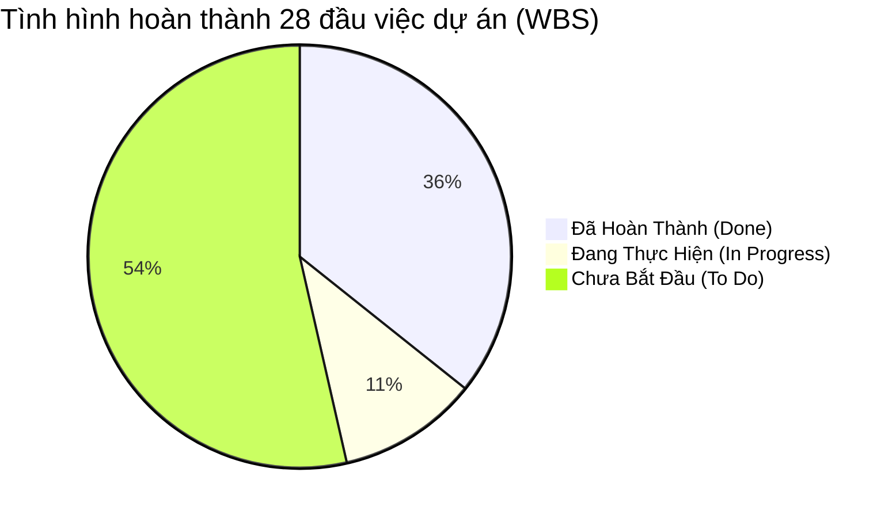

# BẢNG PHÂN CHIA CÔNG VIỆC VÀ THEO DÕI TIẾN ĐỘ DỰ ÁN PBL6
## ĐỀ TÀI: NỀN TẢNG TRỢ LÝ TRI THỨC CÁ NHÂN ĐA NGUỒN (HYBRID RAG + LOCAL LLM)

> **Nhóm thực hiện:** 3 Thành viên  
> **Hệ thống theo dõi Online:** File Excel & Google Sheets đã đồng bộ sẵn trong thư mục [`kehoach/`](file:///D:/PBl6/kehoach)  
> **Đường dẫn file Excel:** [`Phan_Chia_Cong_Viec_Nhom_3_Nguoi_PBL6.xlsx`](file:///D:/PBl6/kehoach/Phan_Chia_Cong_Viec_Nhom_3_Nguoi_PBL6.xlsx)  
> **Đường dẫn file CSV:** [`Phan_Chia_Cong_Viec_Nhom_3_Nguoi.csv`](file:///D:/PBl6/kehoach/Phan_Chia_Cong_Viec_Nhom_3_Nguoi.csv)

---

## 1. Phân Công Vai Trò & Trách Nhiệm Nhóm 3 Người

| STT | Thành Viên / Vai Trò | Phạm Vi Trách Nhiệm Cốt Lõi | Công Cụ & Tech Stack | Tiến Độ Đạt Được |
| :---: | :--- | :--- | :--- | :---: |
| **1** | **Thành viên 1** *(Trưởng nhóm / AI & RAG Specialist)* | • Nghiên cứu & triển khai mô hình LLM cục bộ (**Ollama**, **Qwen 2.5 3B/7B**). • Triển khai **Dense Vector Embedding** (`BAAI/bge-m3`) và **Cross-Encoder Reranker** (`bge-reranker-v2-m3`). • Thuật toán **Reciprocal Rank Fusion (RRF)** gộp kết quả tìm kiếm. • Tối ưu Prompt (đọc hiểu bản chất, trò chuyện, chống ảo giác). • Đánh giá Benchmark định lượng (Hit Rate@5, MRR, Ragas Framework). | Python, Ollama, FastEmbed, ONNX Runtime, PyTorch, Ragas | **45%** *(Đã xong MVP AI & Ollama)* |
| **2** | **Thành viên 2** *(Backend & Data Engineer)* | • Xây dựng **Document Processing Pipeline** (bóc tách PDF, DOCX, PPTX, TXT). • Thuật toán **Smart Recursive Chunking** kèm metadata số trang. • Quản trị CSDL cục bộ **SQLite** & **FTS5 Full-Text Search (BM25)**. • Xây dựng hệ thống API Backend bằng **FastAPI** (RESTful & SSE Streaming). • Tích hợp **Web Search** (DuckDuckGo / Tavily) & **AI Router** định tuyến nguồn. | Python, FastAPI, SQLite, FTS5, PyPDF, Python-docx, Python-pptx, HTTPX | **40%** *(Đã xong CSDL, Parser & API)* |
| **3** | **Thành viên 3** *(Frontend & Feature Developer)* | • Xây dựng giao diện ứng dụng **Web UI / Desktop** (Tailwind CSS, Lucide Icons, React). • Màn hình quản lý **Workspace & Kho tri thức** (Upload kéo-thả, xóa, lọc file). • Giao diện **Chat RAG** tương tác & **Citation Viewer** (xem đoạn trích gốc). • Phát triển tính năng hỗ trợ học tập: **Tóm tắt (Summary)**, **Flashcard lật mặt**, **Trắc nghiệm (Quiz)**. • Thiết kế Slide báo cáo & quay Video Demo sản phẩm. | HTML5, Tailwind CSS, JavaScript/React, Vite, FontAwesome | **30%** *(Đã xong Web UI MVP)* |

---

## 2. Thống Kê Tiến Độ Tổng Thể Tính Đến Hiện Tại

* **Đã hoàn thành:** **10 / 28 tasks (~36%)** — Hoàn thành 100% Giai đoạn 1 (MVP Local Core).
* **Đang thực hiện:** **3 / 28 tasks (~11%)** — Đang triển khai Giai đoạn 2 (Dense Vector BGE-M3 & Citation Modal).
* **Chưa bắt đầu:** **15 / 28 tasks (~53%)** — Các tính năng Online Search, AI Router, Bộ công cụ học tập và Benchmark.

---

## 3. Danh Mục Các Công Việc ĐÃ LÀM ĐƯỢC (Completed Deliverables)

Đây là những đầu việc đã được triển khai hoàn chỉnh và có bằng chứng mã nguồn hoạt động thực tế trên máy tính của bạn:

| Mã Task | Hạng Mục Công Việc Đã Xong | Người Đảm Nhận | Kết Quả Bàn Giao Cụ Thể (Artifacts) | Trạng Thái |
| :---: | :--- | :---: | :--- | :---: |
| **TASK-01** | Khảo sát phần cứng máy (RTX 3050 4GB VRAM, 16GB RAM) & tài liệu đề tài | Thành viên 1 | Tài liệu [`01_So_Sanh_Va_Lua_Chon_Mo_Hinh_AI.md`](file:///D:/PBl6/kehoach/01_So_Sanh_Va_Lua_Chon_Mo_Hinh_AI.md) | ✅ **Hoàn thành** |
| **TASK-02** | So sánh đa tiêu chí 6 họ LLM và chọn `Qwen 2.5 3B` (100% GPU) & `BGE-M3` (CPU ONNX) | Thành viên 1 | Bảng ma trận so sánh định lượng và bộ cấu hình tối ưu Golden Stack | ✅ **Hoàn thành** |
| **TASK-03** | Thiết kế kiến trúc tổng thể, sơ đồ phân tầng, SQLite Schema & API Contract | Thành viên 2 | Tài liệu [`02_Kien_Truc_He_Thong_Va_Ky_Thuat.md`](file:///D:/PBl6/kehoach/02_Kien_Truc_He_Thong_Va_Ky_Thuat.md) | ✅ **Hoàn thành** |
| **TASK-04** | Cài đặt Ollama và kéo model `qwen2.5:3b` (~1.9GB) chạy trên GPU | Thành viên 1 | Ollama chạy cổng 11434, tốc độ sinh text cực nhanh > 40 tokens/s | ✅ **Hoàn thành** |
| **TASK-05** | Xây dựng bộ Document Parser bóc tách sạch file `.pdf`, `.docx`, `.pptx`, `.txt` | Thành viên 2 | File [`app/services/document_service.py`](file:///D:/PBl6/sourcecode/backend/app/services/document_service.py) | ✅ **Hoàn thành** |
| **TASK-06** | Thuật toán Smart Recursive Text Chunking kèm Metadata số trang và index | Thành viên 2 | Hàm `recursive_chunk_text` (~800 ký tự, overlap 150 ký tự) | ✅ **Hoàn thành** |
| **TASK-07** | Khởi tạo CSDL SQLite và Full-Text Search FTS5 (BM25) siêu nhẹ không cần Docker | Thành viên 2 | File CSDL [`data/knowledge.db`](file:///D:/PBl6/sourcecode/backend/data/knowledge.db) & [`database.py`](file:///D:/PBl6/sourcecode/backend/app/database.py) | ✅ **Hoàn thành** |
| **TASK-08** | Nâng cấp AI Prompt: Vừa chào hỏi tự nhiên, vừa đọc hiểu bản chất, tổng hợp ý nghĩa & trích dẫn | Thành viên 1 | File [`app/services/llm_service.py`](file:///D:/PBl6/sourcecode/backend/app/services/llm_service.py) | ✅ **Hoàn thành** |
| **TASK-09** | Xây dựng Giao diện Web UI tương tác trực quan (Kéo thả file, Badge Ollama, Chat RAG) | Thành viên 3 | File giao diện [`app/static/index.html`](file:///D:/PBl6/sourcecode/backend/app/static/index.html) | ✅ **Hoàn thành** |
| **TASK-10** | Đóng gói script 1-click `start_app.bat` & kiểm thử trọn vẹn luồng Local RAG | Cả nhóm | File [`start_app.bat`](file:///D:/PBl6/start_app.bat) chạy mượt mà tại `http://localhost:8000` | ✅ **Hoàn thành** |

---

## 4. Bảng Phân Chia Chi Tiết 28 Công Việc Toàn Bộ Đề Tài (WBS)

| Mã Task | Giai Đoạn | Tên Công Việc | Người Phụ Trách | Ưu Tiên | Trạng Thái | Hạn Chót | Kết Quả Bàn Giao (Deliverables) |
| :---: | :--- | :--- | :---: | :---: | :---: | :---: | :--- |
| **TASK-01** | GĐ 1: MVP Core | Nghiên cứu tài liệu & phân tích phần cứng máy | TV 1 | Cao | ✅ **Đã Xong** | Tuần 1 | Tài liệu phân tích phần cứng & đề tài |
| **TASK-02** | GĐ 1: MVP Core | So sánh mô hình LLM, Embedding, Vector DB | TV 1 | Cao | ✅ **Đã Xong** | Tuần 1 | Ma trận so sánh & chọn Qwen 2.5 3B |
| **TASK-03** | GĐ 1: MVP Core | Thiết kế kiến trúc hệ thống, SQLite & API | TV 2 | Cao | ✅ **Đã Xong** | Tuần 2 | Tài liệu kiến trúc kỹ thuật & API Spec |
| **TASK-04** | GĐ 1: MVP Core | Cài đặt Ollama & tải model Qwen 2.5 3B | TV 1 | Cao | ✅ **Đã Xong** | Tuần 2 | Model Qwen 2.5 3B sẵn sàng trên GPU |
| **TASK-05** | GĐ 1: MVP Core | Bộ Parser tài liệu PDF, DOCX, PPTX, TXT | TV 2 | Cao | ✅ **Đã Xong** | Tuần 2 | Module `document_service.py` |
| **TASK-06** | GĐ 1: MVP Core | Thuật toán Smart Recursive Chunking | TV 2 | Cao | ✅ **Đã Xong** | Tuần 2 | Chunking ~800 chars có overlap |
| **TASK-07** | GĐ 1: MVP Core | CSDL SQLite + Full-Text Search FTS5 (BM25) | TV 2 | Cao | ✅ **Đã Xong** | Tuần 2 | CSDL `knowledge.db` & module DB |
| **TASK-08** | GĐ 1: MVP Core | Retrieval Service & Prompt tổng hợp ý nghĩa | TV 1 | Cao | ✅ **Đã Xong** | Tuần 2 | Trả lời tự nhiên + trích dẫn [Tài liệu X] |
| **TASK-09** | GĐ 1: MVP Core | Giao diện Web UI MVP tương tác kéo thả | TV 3 | Cao | ✅ **Đã Xong** | Tuần 2 | Web UI tại `http://localhost:8000` |
| **TASK-10** | GĐ 1: MVP Core | Kiểm thử tích hợp Local RAG & file batch 1-click | Cả nhóm | Cao | ✅ **Đã Xong** | Tuần 2 | File `start_app.bat` chạy hoàn hảo |
| **TASK-11** | GĐ 2: Hybrid RAG | Tích hợp thư viện fastembed & Dense BGE-M3 | TV 1 | Cao | 🟡 **Đang Làm** | Tuần 3 | Module `embedding_service.py` (1024 dims) |
| **TASK-12** | GĐ 2: Hybrid RAG | Thuật toán Reciprocal Rank Fusion (RRF) | TV 1 | Cao | 🟡 **Đang Làm** | Tuần 4 | Gộp kết quả Dense Vector + BM25 FTS5 |
| **TASK-13** | GĐ 2: Hybrid RAG | Tích hợp Cross-Encoder Reranker BGE-v2-m3 | TV 1 | Cao | ⚪ Chưa bắt đầu | Tuần 4 | Lọc Top 20 lấy Top 4 chunks tinh túy |
| **TASK-14** | GĐ 2: Hybrid RAG | Citation Viewer Modal xem đoạn trích gốc | TV 3 | Trung bình | 🟡 **Đang Làm** | Tuần 4 | Popup xem đoạn văn bản gốc khi bấm link |
| **TASK-15** | GĐ 3: Offline | Network Monitor & giới hạn VRAM GPU < 3.5GB | TV 2 | Trung bình | ⚪ Chưa bắt đầu | Tuần 5 | Module kiểm soát bộ nhớ an toàn |
| **TASK-16** | GĐ 3: Offline | Nút chuyển đổi linh hoạt Qwen 3B và 7B | TV 3 + TV 1 | Trung bình | ⚪ Chưa bắt đầu | Tuần 5 | Model Switcher trên giao diện |
| **TASK-17** | GĐ 4: Web Search | Tích hợp DuckDuckGo Search API tra cứu mạng | TV 2 | Cao | ⚪ Chưa bắt đầu | Tuần 6 | Module `web_search_service.py` |
| **TASK-18** | GĐ 4: Web Search | Scraper làm sạch HTML & trích dẫn URL | TV 2 | Trung bình | ⚪ Chưa bắt đầu | Tuần 6 | Bóc tách bài viết web bỏ qua quảng cáo |
| **TASK-19** | GĐ 5: AI Router | AI Router phân loại intent & thời gian nhạy cảm | TV 1 | Cao | ⚪ Chưa bắt đầu | Tuần 7 | Tự động chọn Local/Web/Hybrid |
| **TASK-20** | GĐ 5: AI Router | Fallback tự động khi mất mạng | TV 2 | Cao | ⚪ Chưa bắt đầu | Tuần 7 | Tự chuyển về Local RAG khi web lỗi |
| **TASK-21** | GĐ 6: Học Tập | API sinh Tóm tắt, Flashcard và Quiz | TV 2 | Cao | ⚪ Chưa bắt đầu | Tuần 8 | Endpoint `/api/v1/study/*` |
| **TASK-22** | GĐ 6: Học Tập | Giao diện Flashcard lật mặt & Bảng Quiz | TV 3 | Cao | ⚪ Chưa bắt đầu | Tuần 9 | Màn hình tương tác Flashcard & Quiz |
| **TASK-23** | GĐ 7: Research | Tính năng đối chiếu đa tài liệu (Multi-doc) | TV 1 | Trung bình | ⚪ Chưa bắt đầu | Tuần 10 | So sánh quan điểm giữa 2-3 tài liệu |
| **TASK-24** | GĐ 7: Research | Xuất báo cáo nghiên cứu tổng hợp Markdown/PDF | TV 3 | Trung bình | ⚪ Chưa bắt đầu | Tuần 11 | Nút xuất báo cáo kèm mục References |
| **TASK-25** | GĐ 8: Benchmark | Xây dựng bộ test Benchmark 50 câu hỏi tiếng Việt | TV 1 | Cao | ⚪ Chưa bắt đầu | Tuần 11 | File `evaluation_dataset.json` |
| **TASK-26** | GĐ 8: Benchmark | Đo lường Hit Rate, MRR, Ragas Faithfulness | TV 1 | Cao | ⚪ Chưa bắt đầu | Tuần 12 | Biểu đồ chứng minh hiệu quả Hybrid RAG |
| **TASK-27** | GĐ 8: Benchmark | Viết toàn bộ Báo cáo Thuyết minh PBL6 | Cả nhóm | Cao | ⚪ Chưa bắt đầu | Tuần 12 | Bản báo cáo đồ án đầy đủ các chương |
| **TASK-28** | GĐ 8: Benchmark | Thiết kế Slide bảo vệ & quay Video Demo | TV 3 | Cao | ⚪ Chưa bắt đầu | Tuần 12 | Slide PPTX chuyên nghiệp & Video 5 phút |

---

## 5. Hướng Dẫn Tải Lên Google Sheets Để Làm Việc Nhóm Online Thời Gian Thực

Để cả 3 bạn có thể cùng mở, chỉnh sửa và cập nhật tiến độ hàng ngày mọi lúc mọi nơi:

1. **Bước 1:** Mở trình duyệt vào Google Drive của bạn: [https://drive.google.com](https://drive.google.com).
2. **Bước 2:** Bấm nút **`+ Mới` (New)** ở góc trái trên cùng -> Chọn **`Tải tệp lên` (File upload)**.
3. **Bước 3:** Điều hướng tới thư mục `D:\PBl6\kehoach\` và chọn file:
   👉 **`Phan_Chia_Cong_Viec_Nhom_3_Nguoi_PBL6.xlsx`**
4. **Bước 4:** Nhấp đúp vào file vừa tải lên trên Drive -> Chọn **Mở bằng Google Trang tính (Open with Google Sheets)**.
5. **Bước 5:** Bấm nút **Chia sẻ (Share)** ở góc trên bên phải -> Nhập địa chỉ Gmail của 2 bạn còn lại trong nhóm và chọn quyền **`Người chỉnh sửa` (Editor)**.
6. **Bước 6:** Hàng tuần khi làm xong bất kỳ task nào, các bạn chỉ cần đổi trạng thái sang **`Đã Hoàn Thành`**, bảng tổng quan sẽ tự động cập nhật phần trăm tiến độ!
